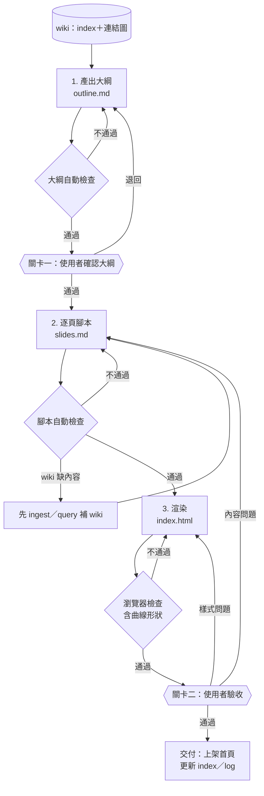

# 總體經濟學 LLM Wiki — Schema

本檔是 LLM（Claude Code）維護此知識庫的規則書。每次 session 開始先讀本檔，再讀 `wiki/index.md` 與 `wiki/log.md` 最後幾筆。

## 1. 目標

- **用途：學習型。** 使用者是總經課程的學生。原始資料是老師的投影片與課本；wiki 的任務是把它們整合成**互相連結的概念網**，用於理解、複習與考試準備。
- 人類負責：提供資料、決定重點、提問。LLM 負責：摘要、建頁、交叉連結、維護一致性、記錄。
- 使用者用 **Obsidian** 瀏覽（vault 根目錄 = 本資料夾）。
- **前提：不安裝額外程式。** 只用 Windows 內建 PowerShell 與 Claude Code 本身的能力。

## 2. 目錄結構

```
LLM WIKI/
├── CLAUDE.md              本檔（schema）
├── raw/                   原始資料 —— LLM 只讀不改
│   ├── papers/            使用者從對話中提供的 PDF 簡報檔
│   ├── slides/            使用者自行放入的老師投影片（.pptx / .pdf）
│   ├── textbook/          課本、講義 PDF
│   ├── converted/         由 tools/ 腳本自動轉出的純文字（可重新產生）
│   └── assets/            原始圖片
├── tools/
│   └── pptx2md.ps1        PPTX → Markdown 文字（PowerShell，免安裝）
├── outputs/               由 wiki 內容產生的成品（不是知識本身）
│   ├── slides/index.html  單元首頁（列出所有單元卡片，點進去才是簡報）
│   ├── slides/<主題>/     outline.md → slides.md → index.html（見 Output 流程）
│   └── diagrams/          流程圖等圖片
└── wiki/                  LLM 擁有並維護
    ├── index.md           內容目錄（每次 ingest 必更新）
    ├── log.md             時間序紀錄（只能附加）
    ├── overview.md        全課程地圖與學習路徑
    ├── glossary.md        中英術語 + 符號對照表
    ├── models/            模型
    ├── concepts/          概念
    ├── indicators/        總經指標
    ├── policies/          政策
    ├── schools/           學派
    ├── people/            人物
    ├── events/            歷史事件（含歷史數據）
    ├── sources/           每份原始資料一頁摘要
    └── synthesis/         比較、整合、查詢回答回存
```

`raw/` 中除了 `converted/` 由腳本產生、`papers/` 由 LLM 存入對話提供的檔案外，LLM **絕不修改、刪除、改名** raw 內任何檔案。

**對話中提供的 PDF 簡報檔 → 一律存入 `raw/papers/`**：
- 附件有本機路徑時，用 PowerShell `Copy-Item` 複製進 `raw/papers/`，保留原檔名（不搬移、不改原檔）。
- 若同名檔已存在，先告知使用者，不覆蓋。
- 若附件沒有可複製的本機檔案（只有內容），請使用者自行把檔案放進 `raw/papers/`，不要用文字重建 PDF。

## 3. 頁面類型與模板

### 共通規則

- **檔名**：繁體中文頁名，必要時括號附英文縮寫。例：`IS-LM 模型.md`、`國內生產毛額 (GDP).md`、`凱因斯學派.md`。檔名即 Obsidian 頁名，全庫唯一。
- **連結**：一律用 Obsidian wikilink `[[頁名]]`，或 `[[頁名|顯示文字]]`。只連到已存在或本次一起建立的頁；尚未建立但重要的概念可以先連，並在 lint 時處理。
- **出處**：重要論述句尾標註來源，格式 `（[[sources/頁名]] p.12）` 或 `（[[第3週 投影片]] 第 8 張）`。
- **每頁開頭都有 YAML frontmatter**：

```yaml
---
type: model | concept | indicator | policy | school | person | event | source | synthesis
aliases: [英文名, 縮寫, 常見別名]
tags: [短期, 長期, 開放經濟, 貨幣, 財政, ...]
sources: [來源頁名, ...]
updated: YYYY-MM-DD
---
```

### 模型頁 `models/`（最重要的頁型）

```markdown
# IS-LM 模型
> 一句話：短期、物價固定下，商品市場與貨幣市場同時均衡決定 Y 與 r。

## 適用範圍與假設
## 變數
| 內生 | 外生 / 政策變數 |
## 方程式
$$ Y = C(Y-T) + I(r) + G $$
## 圖形（文字＋示意）
## 衝擊分析
| 衝擊 | 曲線移動 | Y | r | 其他 |
## 直覺與傳導機制
## 限制與批評
## 與其他模型的關係
## 常見考點與誤解
## 來源
```

### 概念頁 `concepts/`
`定義 → 公式（若有）→ 直覺 → 例子 → 常見誤解 → 相關頁 → 來源`

### 指標頁 `indicators/`
`定義 → 計算方式 → 衡量問題/偏誤 → 相關指標比較 → 歷史案例數值（標日期與出處） → 來源`

### 政策頁 `policies/`
`目標 → 工具 → 傳導機制 → 各模型下的效果 → 各學派看法 → 歷史案例 → 來源`

### 學派頁 `schools/`
`時代背景 → 核心主張 → 代表人物 → 偏好的模型 → 政策立場 → 與其他學派的分歧 → 來源`

### 人物頁 `people/`
`簡介（年代、國籍）→ 主要貢獻 → 相關模型/學派 → 來源`

### 事件頁 `events/`
`時間軸 → 發生了什麼 → 關鍵歷史數據（表格，標出處）→ 用哪些模型解釋 → 政策回應 → 啟示 → 來源`

### 來源頁 `sources/`
檔名：`第N週 主題.md` 或 `課本 Ch.N 主題.md`。
`基本資訊（檔案路徑、日期、章節）→ 重點摘要（條列）→ 本份新增/更新了哪些 wiki 頁 → 疑問與待查 → 與其他來源的差異`

### 綜合頁 `synthesis/`
比較表、跨章節整合、使用者提問的好回答。例：`短期 vs 長期.md`、`IS-LM 與 AD-AS 的關係.md`。

## 4. 圖形呈現（不需安裝任何程式）

總經圖形以下列方式呈現，**依序優先**：

1. **文字衝擊鏈（必備）**：`G↑ → IS 右移 → Y↑, r↑ → I↓（排擠）`
2. **衝擊分析表**：各衝擊對每條曲線與各變數的影響（↑ ↓ — ?）。
3. **Mermaid 流程圖**（Obsidian 內建可渲染）：用於傳導機制、因果鏈、學派關係。
   ````markdown
   ```mermaid
   flowchart LR
     A[央行降息] --> B[r↓] --> C[投資 I↑] --> D[總需求 AD↑] --> E[Y↑, P↑]
   ```
   ````
4. **ASCII 示意圖（選用）**：標示座標軸、曲線名稱、移動方向即可，不求精確。
   ```
    r │  LM
      │   ╲  ╱
      │    ╳      IS → IS'（右移）
      │   ╱  ╲
      └──────── Y
   ```
5. 投影片原圖：若 `raw/assets/` 有圖，可用 `![[檔名.png]]` 嵌入。

## 5. 書寫規範

- **語言**：台灣繁體中文；術語**首次出現時附英文**，例「國內生產毛額（Gross Domestic Product, GDP）」，之後只用中文或縮寫。避免大陸用語（通脹→通膨、質量→品質、信息→資訊）。
- **新術語**一律加入 `glossary.md`（中文、英文、縮寫、連結頁）。
- **數學式**用 LaTeX：行內 `$...$`，獨立 `$$...$$`。
- **符號**：wiki 統一採用一套符號，並記錄在 `glossary.md` 的「符號對照」表；投影片或課本用不同符號時，在對照表註明。
- **數據**：只放**歷史案例數據**（例如 1970s 停滯性通膨、2008 金融海嘯、COVID），一律標註年份與出處。不追蹤即時最新值。
- 寫給「準備考試的學生」看：先講直覺，再講公式；多用表格比較。

### 矛盾與差異標記

| 標記 | 意義 | 處理 |
|---|---|---|
| ⚠️ **事實矛盾** | 來源間事實或推導不一致 | 兩說並陳、標出處，向使用者確認 |
| 🔀 **學派分歧** | 不同學派的觀點差異，不是錯誤 | 保留雙方，連到學派頁 |
| 🔣 **符號差異** | 同一概念的符號或定義寫法不同 | 記入 glossary 符號對照表 |

## 6. 工作流程

### Ingest（一次一份，使用者陪同）

1. 使用者把檔案放進 `raw/slides/` 或 `raw/textbook/` 並告知；或在對話中直接給 PDF 簡報檔，由 LLM 先存入 `raw/papers/`（見 §2）。
2. **轉文字**：
   - PDF：Claude Code 直接讀取（大檔分頁讀）。
   - PPTX：執行 `powershell -ExecutionPolicy Bypass -File tools/pptx2md.ps1 "raw/slides/檔名.pptx"`，輸出到 `raw/converted/檔名.md`，再讀取。
3. **先討論再寫**：向使用者列出 3–7 個關鍵重點、將新增或更新的頁面清單、發現的矛盾或疑點；等使用者回饋後再寫入。
4. 建立 `sources/` 來源頁。
5. 新增或更新相關的 models / concepts / indicators / policies / schools / people / events 頁（一份來源常觸及 5–15 頁）。更新時**整合**進既有內容，不要只在末尾堆疊。
6. 更新 `glossary.md`、`overview.md`（若課程地圖有變）。
7. 更新 `index.md`。
8. 在 `log.md` 附加紀錄。
9. 回報：新增了哪些頁、修改了哪些頁、有哪些待確認事項。

### Query（提問）

1. 先讀 `index.md` 找相關頁，再深入閱讀。
2. 回答時用 `[[頁名]]` 引用 wiki 頁。
3. 若回答有保存價值（比較、整合、解題思路），詢問使用者是否存成 `synthesis/` 新頁，存了就更新 index 與 log。
4. 若 wiki 內容不足以回答，明說缺什麼，並建議要補哪份資料。

### Output：簡報產生 graph（2026-11-23 以第3章試跑驗證）

做簡報時一律走這張流程圖：三個**產出節點**，每個後面接**自動檢查**（不通過就退回同一節點重做＝loop），加上兩道**使用者關卡**。



#### 共通原則
- 內容**只取自 wiki**（不直接從 raw 取材）；wiki 缺的先補進 wiki 再回來。
- 每份簡報一個資料夾：`outputs/slides/<主題>/`，內含 `outline.md`、`slides.md`、`index.html`，三者都保留（之後可只改一頁）。
- 預設 **1 個大綱方案、15–25 頁**（約 20 分鐘）。
- 對象是**不熟悉該主題的初學者**：先問題與直覺、生活比喻，再公式；每頁一個重點。
- 使用者的 📝 課堂筆記以「我的課堂筆記」便利貼呈現。
- 單一 .html 檔、不引用外部 CDN，離線可開；圖形用內嵌 SVG，公式用 HTML 排版。

#### 節點 1：產出大綱 → `outline.md`
- 讀 `index.md`、來源頁與相關 wiki 頁；用連結圖的**被連入數**判斷重點程度（連入多的主題分配較多頁）。
- 內容：故事線（一個貫穿全份的問題）、段落、逐頁表格：`# | 標題 | 版型 | 一句話重點 | 圖／比喻 | wiki | 📝`。
- **自動檢查**：頁數 15–25；每頁有一句話重點；wiki 連結有效；來源頁重點逐條有對應頁；前置概念排在前面；有開場案例與收尾回顧。提醒：未用到的 wiki 頁、刻意省略的內容。
- 注意：wiki 連結**沒有方向**，前置順序目前需讀頁面內容判斷（日後可在 frontmatter 加 `prereq:` 自動化）。
- **關卡一**：使用者看故事線、每頁一句話重點與圖／比喻，確認方向。大方向問題要在這一關抓出來，因為腳本不再經人工確認。

#### 節點 2：逐頁腳本 → `slides.md`
- 每頁 `## Pxx 標題`，欄位：版型、重點、內容要點、比喻／例子、公式、視覺（圖表代號與參數）、📝、出處。渲染時只排版，不新增內容。
- **自動檢查**（硬性 = 不過就退回）：每頁有重點與出處（硬性）；出處連結有效（硬性）；符號與 glossary 一致，例如折舊率用 δ（硬性）；台灣用語（硬性）；數字與 wiki 一致（硬性）；補充／延伸思考有標示（硬性）；先直覺後公式（提醒）；字數密度（提醒，約 150–250 字／頁，>300 標出）。
- 結果寫在 `slides.md` 末尾。

#### 節點 3：渲染 → `index.html`
- **從模板＋`slides.md` 重新產生**，不要拿舊簡報修改（試跑時沿用舊檔殘留了 3 個舊標題）。
- 模板：`outputs/slides/第3章/index.html` 的 `<style>`、SVG 濾鏡、`chart()` 圖表函式與導覽程式。
- **預設樣式：黑板教學風**（使用者偏好）：深綠黑板＋粉筆質感（SVG 濾鏡，`filterUnits="userSpaceOnUse"` 以免水平／垂直線消失）、木框與粉筆槽導覽列、微軟正黑體等現代無襯線字型（**不用標楷體**，使用者覺得老氣）、粉筆白／黃／粉／藍／綠配色、課堂筆記做成釘在黑板上的便利貼。
- **版面不留大塊空白**：封面用左右兩欄填滿；內容頁寬度 1360px，大螢幕加大字級。
- **瀏覽器檢查**（在 1900×980 與 375×812 各跑一次）：頁數與標題和腳本一致；每頁不超出版面（scrollHeight）；圖表文字不重疊（bounding box）；手機無橫向捲動；無頁面錯誤；寬螢幕無大塊留白；**曲線形狀符合原簡報描述**（逐張看截圖，並對關鍵曲線用程式驗證：該單調的要單調、交點數量正確、穩定／不穩定的箭頭方向正確、凹凸與原圖一致）。結果寫在 `slides.md` 末尾。
- **關卡二**：使用者驗收。內容問題退回節點 2，樣式問題退回節點 3。

#### 交付
- **更新單元首頁** `outputs/slides/index.html`：只改檔案中的 `UNITS` 陣列，把新單元設為 `status: 'ready'`（章次、標題、貫穿問題、3–4 個概念標籤、頁數、分鐘、`href: '<主題>/index.html'`、顏色），並移除一張 `soon` 佔位卡；單元依章次排序。
- 每份簡報導覽列都要有「🏠 首頁」連結（`href="../index.html"`，模板已內建）。
- `index.md` 的「產出 Outputs」列出資料夾；log.md 記一筆 `output`，含各節點檢查結果與試跑／製作中發現的問題。

### Lint（健康檢查，使用者要求時或每 5 份來源後建議一次）

檢查並回報（先回報，經同意再修）：
- 頁面間的矛盾（依 §5 標記分類）
- 孤兒頁（沒有任何頁連入）
- 被連結但尚未建立的頁（紅色連結）
- 被多頁提到卻沒有自己頁面的重要概念
- frontmatter 缺漏、模板章節缺漏
- glossary 漏收的術語、符號不一致
- index 與實際檔案不同步
- 建議的延伸問題與該補的資料

## 7. index.md 與 log.md 格式

**index.md**：依頁型分類，每頁一行：`- [[頁名]] — 一句話摘要（來源數 N）`。

**log.md**：只能附加，最新在最下面。每筆標題格式固定：

```
## [YYYY-MM-DD] ingest | 第3週 IS-LM 模型
- 新增：[[IS-LM 模型]]、[[流動性偏好理論]]
- 更新：[[凱因斯十字架]]、[[glossary]]
- 待確認：投影片 p.14 的乘數推導與課本不同（⚠️）
```

動作類型：`ingest` | `query` | `output` | `lint` | `schema`（修改本檔時）。

### 課堂筆記
原始投影片上的中文手寫註記是**使用者本人的課堂筆記**。收錄時標為「📝 課堂筆記」，並註明張次。

## 8. Schema 演進

本檔由使用者與 LLM 共同修訂。工作中發現規則不合用時，提出修改建議，經使用者同意後更新本檔，並在 log.md 記一筆 `schema`。

## 9. 版本與備份

目前未安裝 git，版本紀錄依賴 **OneDrive 版本歷史**（在檔案上按右鍵 → 版本歷程記錄）。日後若安裝 git，再加 `.gitignore` 並初始化 repo。
