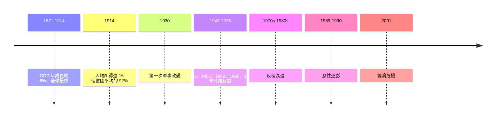

# 阿根廷的世紀衰退（A Century of Decline）

> 第 3 章的開場案例，出自《The Economist》2014 年 2 月 15 日的報導 "A century of decline: The tragedy of Argentina"。（[第3章 成長與累積](../sources/%E7%AC%AC3%E7%AB%A0%20%E6%88%90%E9%95%B7%E8%88%87%E7%B4%AF%E7%A9%8D.md) 第 2 張）

## 時間軸

## 發生了什麼
- **黃金時期**：1914 年以前的 43 年間，GDP 年成長率約 **6%**，是當時全球紀錄上最快的。人均所得是 16 個富裕經濟體平均的 **92%**。當年的繁榮留下了科隆劇院（Teatro Colón，1908 年開幕）和雷蒂羅車站（Retiro，1915 年完工）等建設。（第 2 張）
- **衰退**（第 3 張）：
  - 軍事政變：1930 年第一次，之後 1943、1955、1962、1966、1976 年陸續發生
  - 1970–80 年代：反覆衰退
  - 1989–90 年：**惡性通膨**（hyperinflation）
  - 2001 年：經濟危機

## 衰退的三個原因（第4章）
[顧志耐 (Simon Kuznets)](../people/%E9%A1%A7%E5%BF%97%E8%80%90%20%28Simon%20Kuznets%29.md) 據說曾說：「世界上有四種國家：已開發國家、未開發國家、日本和阿根廷。」（[第4章 成長與政策](../sources/%E7%AC%AC4%E7%AB%A0%20%E6%88%90%E9%95%B7%E8%88%87%E6%94%BF%E7%AD%96.md) 第 2 張）

| 原因 | 內容 |
|---|---|
| 1. 外部衝擊 | （簡報僅列標題） |
| 2. 貿易政策 | 二戰後走向**封閉經濟**，在貝隆（Perón）領導下持續；1946 年設立外貿管制機構，貿易占 GDP 比例逐漸下降（第 3 張） |
| 3. 缺乏制度 | 缺乏能制定長期國家政策的制度：總統可連任；2012 年將西班牙 Repsol 持股的石油公司 YPF 收歸國有（第 3 張） |

→ 對應到[成長政策](../policies/%E6%88%90%E9%95%B7%E6%94%BF%E7%AD%96.md)：貿易開放與制度品質會影響投資、技術引進與生產力。

## 2021 年：新興市場最脆弱（第13章）
在 The Economist 的新興市場脆弱度指數中，阿根廷以 **33 分排名最脆弱**：通膨超過 **50%**，經濟危機加深。（[第13章 國際連結](../sources/%E7%AC%AC13%E7%AB%A0%20%E5%9C%8B%E9%9A%9B%E9%80%A3%E7%B5%90.md) 第 3 張；見[2022 新興市場風險](2022%20%E6%96%B0%E8%88%88%E5%B8%82%E5%A0%B4%E9%A2%A8%E9%9A%AA.md)）

## 關鍵歷史數據
**阿根廷/美國 實質人均 GDP 比值（PPP，Maddison 資料）**（第 3 張圖表，數值為目測約值）

| 年份 | 約略比值 |
|---|---|
| 1875 | 0.65 |
| 1895 前後（高峰） | 約 1.05 |
| 1930 年代初 | 約 0.8 |
| 1945 | 約 0.45 |
| 1950–1975 | 約 0.45–0.5 |
| 2002（谷底） | 約 0.25 |
| 2015 | 約 0.32 |

→ 和美國的相對差距，在一百多年間從接近持平擴大到只剩約三分之一。

## 用哪些模型解釋
簡報在這裡提出問題：「What else is causing the recession?（還有什麼原因造成衰退？）」本章給出的分析框架是：
- [成長核算](../concepts/%E6%88%90%E9%95%B7%E6%A0%B8%E7%AE%97.md)：拆解產出成長中，來自勞動、資本、技術的各是多少。
- [Solow 新古典成長模型](../models/Solow%20%E6%96%B0%E5%8F%A4%E5%85%B8%E6%88%90%E9%95%B7%E6%A8%A1%E5%9E%8B.md)：儲蓄、人口成長、技術如何決定長期所得水準。
- 政治不穩定、惡性通膨會打擊儲蓄與投資，也會降低[全要素生產力 (TFP)](../concepts/%E5%85%A8%E8%A6%81%E7%B4%A0%E7%94%9F%E7%94%A2%E5%8A%9B%20%28TFP%29.md)。這是把案例套進模型的延伸思考，非簡報原文。

## 啟示
曾經富裕不保證持續富裕；[收斂](../concepts/%E6%94%B6%E6%96%82.md)不是必然的，而是取決於各國的儲蓄、人口和技術（制度）等條件。

## 來源
- [第3章 成長與累積](../sources/%E7%AC%AC3%E7%AB%A0%20%E6%88%90%E9%95%B7%E8%88%87%E7%B4%AF%E7%A9%8D.md) 第 2–3 張
- [第4章 成長與政策](../sources/%E7%AC%AC4%E7%AB%A0%20%E6%88%90%E9%95%B7%E8%88%87%E6%94%BF%E7%AD%96.md) 第 2–3 張（三個衰退原因、顧志耐名言）
- [第13章 國際連結](../sources/%E7%AC%AC13%E7%AB%A0%20%E5%9C%8B%E9%9A%9B%E9%80%A3%E7%B5%90.md) 第 3 張（2021 年脆弱度指數）
- 原始報導：*The Economist*, "A century of decline: The tragedy of Argentina", 2014-02-15（經簡報轉引）
