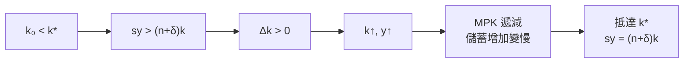

# Solow 新古典成長模型

> 一句話：儲蓄帶來投資、投資累積成資本，但因為資本的[邊際報酬遞減](../concepts/%E9%82%8A%E9%9A%9B%E5%A0%B1%E9%85%AC%E9%81%9E%E6%B8%9B.md)，經濟最終會停在[穩態](../concepts/%E7%A9%A9%E6%85%8B.md)。**長期的人均成長只能來自技術進步。**

由 [梭羅 (Robert Solow)](../people/%E6%A2%AD%E7%BE%85%20%28Robert%20Solow%29.md) 提出，重點放在**資本累積**和**儲蓄決策**之間的連結。（[第3章 成長與累積](../sources/%E7%AC%AC3%E7%AB%A0%20%E6%88%90%E9%95%B7%E8%88%87%E7%B4%AF%E7%A9%8D.md) 第 14 張）

📝 課堂筆記把邏輯濃縮成一句：「儲蓄決定投資，投資決定資本」。

## 適用範圍與假設
- **長期**模型，處理的是經濟成長，不處理景氣波動。
- 人均生產函數 $y = f(k)$，資本的邊際產出為正但遞減（[邊際報酬遞減](../concepts/%E9%82%8A%E9%9A%9B%E5%A0%B1%E9%85%AC%E9%81%9E%E6%B8%9B.md)）。（第 16 張）
- 儲蓄是所得的固定比例：每人儲蓄 $= sy = sf(k)$，$s$ 是儲蓄率。（第 17 張）
  - 儲蓄行為本身的理論（為什麼存、存多少、隨年齡怎麼變）見[第14章 消費與儲蓄](../sources/%E7%AC%AC14%E7%AB%A0%20%E6%B6%88%E8%B2%BB%E8%88%87%E5%84%B2%E8%93%84.md)的[生命週期理論](%E7%94%9F%E5%91%BD%E9%80%B1%E6%9C%9F%E7%90%86%E8%AB%96.md)、[預防性儲蓄與緩衝儲備](../concepts/%E9%A0%90%E9%98%B2%E6%80%A7%E5%84%B2%E8%93%84%E8%88%87%E7%B7%A9%E8%A1%9D%E5%84%B2%E5%82%99.md)（連結為補充）。
- 商品市場均衡：每人投資 = 每人儲蓄，$i = sy$。（第 19 張）
  - 企業為什麼投資、投資多快，見第15章的[最適資本存量](%E6%9C%80%E9%81%A9%E8%B3%87%E6%9C%AC%E5%AD%98%E9%87%8F.md)、[彈性加速模型](%E5%BD%88%E6%80%A7%E5%8A%A0%E9%80%9F%E6%A8%A1%E5%9E%8B.md)（連結為補充）。
- 人口（勞動力）以固定速率 $n$ 成長，資本以固定速率 $\delta$ 折舊。
- 基本版先假設**沒有技術進步**（$\Delta A / A = 0$），之後再加入。（第 14、27 張）

## 變數
| 內生變數 | 外生 / 參數 |
|---|---|
| $k$ 每人資本（資本-勞動比，$K/N$） | $s$ 儲蓄率 |
| $y$ 每人產出（$Y/N$） | $n$ 人口成長率 |
| $c$ 每人消費 | $\delta$ 折舊率 |
| | $g$ 技術進步率（$\Delta A/A$） |

## 方程式
人均生產函數：
$$ y = f(k) \qquad (6) $$

**資本運動方程式**（law of motion of capital）：
$$ \Delta k = sf(k) - (n+\delta)k \qquad (7) $$

- $sf(k)$：每人儲蓄，也就是每人投資，讓 $k$ 增加。
- $(n+\delta)k$：讓 $k$ 減少的部分，也就是[損益兩平投資](../concepts/%E6%90%8D%E7%9B%8A%E5%85%A9%E5%B9%B3%E6%8A%95%E8%B3%87.md)。
  - $\delta k$：機器折舊
  - $nk$：新進人口也要配給資本，把每人資本「稀釋」掉

**穩態條件**（$\Delta k = 0$）：
$$ sf(k^*) = (n+\delta)k^* \qquad (8) $$

人均消費：
$$ c = (1-s)y $$

## 圖形（文字＋示意）

縱軸是每人產出，橫軸是每人資本 $k$。圖上有三條線：

- $f(k)$：生產函數，往上凹，愈來愈平
- $sf(k)$：儲蓄曲線，形狀和 $f(k)$ 一樣，但整條按 $s$ 比例縮小
- $(n+\delta)k$：損益兩平投資，是一條從原點出發的直線

**$sf(k)$ 和 $(n+\delta)k$ 的交點 C** 就是穩態 $k^*$。從 $k^*$ 往上對到 $f(k)$ 的點 D，就是穩態所得 $y^*$。（Figure 3-4，第 20 張）

```
 y │                          ____----‾‾‾ f(k)
   │                 ___---‾‾‾
   │           __--‾‾                ／ (n+δ)k
   │        _-‾                  ／
   │      /                  ／ ____----‾‾ sf(k)
   │     /              _C‾‾‾
   │    /         __--／
   │   /     _--‾ ／
   │  /  _-‾  ／
   │ / -‾ ／
   │/_／
   └──────────────────┼────────────── k
                      k*
   k < k*：sf(k) 在直線上方 → Δk > 0 → k 往右走
   k > k*：sf(k) 在直線下方 → Δk < 0 → k 往左走
```

**收斂過程**（第 18、21 張）：



## 衝擊分析
| 衝擊 | 曲線移動 | $k^*$ | $y^*$ | 穩態人均成長率 | 穩態總產出成長率 |
|---|---|---|---|---|---|
| 儲蓄率 $s$↑ | $sf(k)$ 上移 | ↑ | ↑ | 不變（0） | 不變（$n$） |
| 人口成長率 $n$↑ | $(n+\delta)k$ 變陡（往左上旋轉） | ↓ | ↓ | 不變（0） | ↑（新的 $n$） |
| 折舊率 $\delta$↑ | $(n+\delta)k$ 變陡 | ↓ | ↓ | 不變（0） | 不變（$n$） |
| 技術進步 $g > 0$ | $f(k)$ 和 $sf(k)$ 每年持續上移 | 持續↑ | 持續↑ | $g$ | $n+g$ |

（$s$：第 23 張；$n$：第 26 張；$g$：第 27–28 張；$\delta$ 由公式推得）

更完整的比較（含過渡期）見 [s、n、g 變動效果比較](../synthesis/s%E3%80%81n%E3%80%81g%20%E8%AE%8A%E5%8B%95%E6%95%88%E6%9E%9C%E6%AF%94%E8%BC%83.md)。

### 儲蓄率上升的過渡過程（第 23–25 張）
衝擊鏈：
`s↑ → sf(k) 上移 → 在原本的 k* 處 sy > (n+δ)k → Δk > 0 → k 從 k* 增加到 k** → y 從 y* 增加到 y** → 回到穩態，成長率回到 n`

- **過渡期**（$t_0$ 到 $t_1$）：資本成長得比勞動力和折舊快，所以總產出成長率和人均產出成長率都**暫時上升**。
- 隨著資本累積，成長率逐漸下降，最後回到 $n$。
- Figure 3-6：(a) $y$ 從 $y^*$ 平滑上升到 $y^{**}$；(b) $\Delta Y/Y$ 在 $t_0$ 突然跳高，之後遞減回到 $n$。

📝 課堂筆記：「s 只能提高所得水準 y，長期成長率由 n 決定」。

```
 ΔY/Y │    ┃╲
      │    ┃ ╲
      │    ┃  ╲___
    n │────┛      ‾‾‾‾‾‾‾‾‾────── n
      └────┼──────────┼──────── t
           t₀         t₁
```

### 為什麼儲蓄不影響長期成長率？
因為[邊際報酬遞減](../concepts/%E9%82%8A%E9%9A%9B%E5%A0%B1%E9%85%AC%E9%81%9E%E6%B8%9B.md)：每多一單位資本帶來的產出愈來愈少，新增的儲蓄最後只夠抵銷折舊和新增人口所需的資本，$k$ 就不會再增加。（📝 課堂筆記，第 14、23 張）

## 加入技術進步（第 27–28 張）
令 $g = \Delta A / A$。生產函數 $y = Af(k)$ 每年上移 $g$%，儲蓄曲線也平行上移，所以 $k^*$、$y^*$ 隨時間持續增加。（Figure 3-7）

技術進入生產函數有兩種方式：

| 類型 | 生產函數 | 人均成長核算 |
|---|---|---|
| **勞動擴張型**（labor augmenting） | $Y = F(K, AN)$ | $\frac{\Delta y}{y} = \theta\frac{\Delta k}{k} + (1-\theta)\frac{\Delta A}{A}$；穩態時 $y^*$、$k^*$ 都以 $g$ 成長 |
| **全要素生產力型**（[TFP](../concepts/%E5%85%A8%E8%A6%81%E7%B4%A0%E7%94%9F%E7%94%A2%E5%8A%9B%20%28TFP%29.md)） | $Y = AF(K, N)$ | $\frac{\Delta y}{y} = \theta\frac{\Delta k}{k} + g$ |

結論：在 Solow 模型裡，**長期的人均所得成長率等於技術進步率 $g$**，而 $g$ 是外生給定的，模型本身不解釋它從哪裡來。

## 黃金法則
選一個儲蓄率，讓**穩態人均消費**最大：$f'(k_g^*) = n + \delta$。詳見 [黃金法則](../concepts/%E9%BB%83%E9%87%91%E6%B3%95%E5%89%87.md)。

## 直覺與傳導機制
- 窮國（$k$ 低）的資本邊際產出高，同樣的儲蓄帶來比較多的成長，所以有[收斂](../concepts/%E6%94%B6%E6%96%82.md)的傾向。
- 儲蓄是「水準效果」（level effect），不是「成長效果」（growth effect）。
- 人口成長快，每人分到的資本被稀釋，所以人均所得比較低。這種現象在許多開發中國家都觀察得到。（第 26 張）

## 限制與批評
- 技術進步是**外生**的，模型解釋不了長期成長最根本的來源。
- 預測穩態下儲蓄率和成長率**無關**。
- 以上兩點是 1980 年代末對新古典理論的主要不滿，促成了[內生成長理論](%E5%85%A7%E7%94%9F%E6%88%90%E9%95%B7%E6%A8%A1%E5%9E%8B%20%28AK%20%E6%A8%A1%E5%9E%8B%29.md)。（[第4章 成長與政策](../sources/%E7%AC%AC4%E7%AB%A0%20%E6%88%90%E9%95%B7%E8%88%87%E6%94%BF%E7%AD%96.md) 第 5 張）
- 不過 [巴羅 (Robert Barro)](../people/%E5%B7%B4%E7%BE%85%20%28Robert%20Barro%29.md) 的實證支持新古典的條件收斂（第4章第 17 張）。比較見[新古典 vs 內生成長理論](../synthesis/%E6%96%B0%E5%8F%A4%E5%85%B8%20vs%20%E5%85%A7%E7%94%9F%E6%88%90%E9%95%B7%E7%90%86%E8%AB%96.md)。
- 擴充版：人口成長率隨所得變動 → [內生人口成長的 Solow 模型](%E5%85%A7%E7%94%9F%E4%BA%BA%E5%8F%A3%E6%88%90%E9%95%B7%E7%9A%84%20Solow%20%E6%A8%A1%E5%9E%8B.md)（多重均衡、[貧窮陷阱](../concepts/%E8%B2%A7%E7%AA%AE%E9%99%B7%E9%98%B1.md)）。
- 儲蓄率、人口成長率都假設成固定、外生。
- 基本模型沒有[人力資本](../concepts/%E4%BA%BA%E5%8A%9B%E8%B3%87%E6%9C%AC.md)；加入人力資本後（Mankiw-Romer-Weil）對跨國所得差異的解釋力比較好。

## 與其他模型的關係
- 用[成長核算](../concepts/%E6%88%90%E9%95%B7%E6%A0%B8%E7%AE%97.md)可以拆解實際的成長來源；Solow 模型則解釋資本**怎麼**累積。（第 4 張：成長核算拆解「過去」的貢獻，成長理論解釋「未來」的累積）
- 建立在[生產函數](../concepts/%E7%94%9F%E7%94%A2%E5%87%BD%E6%95%B8.md)之上。

## 常見考點與誤解
- ❌「提高儲蓄率可以永久提高經濟成長率」→ ✅ 只能提高穩態**水準**；成長率只在過渡期暫時上升。
- ❌「人口成長率上升，總產出成長率下降」→ ✅ 穩態總產出成長率 $= n$，所以 $n$↑ 會讓總產出成長率**上升**；下降的是人均水準 $y^*$。
- ❌「儲蓄率愈高愈好」→ ✅ 超過[黃金法則](../concepts/%E9%BB%83%E9%87%91%E6%B3%95%E5%89%87.md)儲蓄率之後，穩態消費反而會下降。
- 穩態時：人均變數 $\Delta y = 0$，所以總產出成長率 $\frac{\Delta Y}{Y} = \frac{\Delta y}{y} + \frac{\Delta N}{N} = n$。（📝 課堂筆記，第 8 張）
- 圖上的移動方向：$s$ 變動是**曲線** $sf(k)$ 移動；$n$、$\delta$ 變動是**直線** $(n+\delta)k$ 旋轉。

## 來源
- [第3章 成長與累積](../sources/%E7%AC%AC3%E7%AB%A0%20%E6%88%90%E9%95%B7%E8%88%87%E7%B4%AF%E7%A9%8D.md) 第 14–28 張
