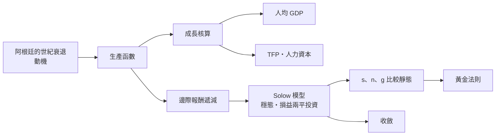
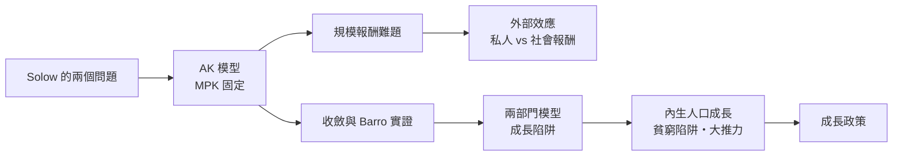
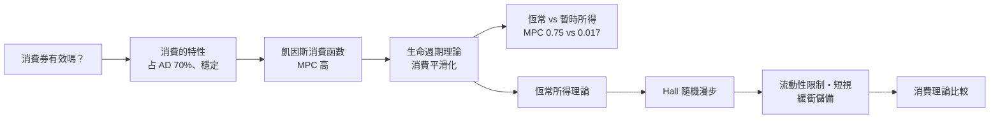

# 總體經濟學課程總覽

> 本頁是整門課的地圖，依**實際收錄的 5 章**整理（2026-11-24 健康檢查後改寫）。課程分成兩條主線：**長期成長**（第3、4章）與**總需求的組成與開放經濟**（第14、13、15章），中間由 [總需求](concepts/%E7%B8%BD%E9%9C%80%E6%B1%82.md) 串起來。

## 課程地圖

```mermaid
flowchart TD
  subgraph 長期：經濟成長
    C3[第3章 成長與累積<br/>Solow 模型] --> C4[第4章 成長與政策<br/>內生成長・貧窮陷阱]
  end
  subgraph 短期：總需求 AD = C + I + G + NX
    C14[第14章 消費與儲蓄<br/>C・MPC] --> C13[第13章 國際連結<br/>NX・IS-LM・Mundell-Fleming]
    C13 --> C15[第15章 投資支出<br/>I・租賃成本・K*]
  end
  C3 -. 儲蓄率 s .-> C14
  C3 -. 投資累積資本 .-> C15
```
箭頭＝建議閱讀順序（首頁「建議先看」）；虛線＝跨主線的概念連結。

## 主要單元
| 單元 | 核心問題 | 主要頁面 | 建議先看 |
|---|---|---|---|
| 第3章 成長與累積 | 為什麼有些國家愈來愈富？ | [Solow 新古典成長模型](models/Solow%20%E6%96%B0%E5%8F%A4%E5%85%B8%E6%88%90%E9%95%B7%E6%A8%A1%E5%9E%8B.md)、[成長核算](concepts/%E6%88%90%E9%95%B7%E6%A0%B8%E7%AE%97.md)、[黃金法則](concepts/%E9%BB%83%E9%87%91%E6%B3%95%E5%89%87.md) | — |
| 第4章 成長與政策 | 政策能讓國家變富嗎？ | [內生成長模型 (AK 模型)](models/%E5%85%A7%E7%94%9F%E6%88%90%E9%95%B7%E6%A8%A1%E5%9E%8B%20%28AK%20%E6%A8%A1%E5%9E%8B%29.md)、[兩部門成長模型](models/%E5%85%A9%E9%83%A8%E9%96%80%E6%88%90%E9%95%B7%E6%A8%A1%E5%9E%8B.md)、[內生人口成長的 Solow 模型](models/%E5%85%A7%E7%94%9F%E4%BA%BA%E5%8F%A3%E6%88%90%E9%95%B7%E7%9A%84%20Solow%20%E6%A8%A1%E5%9E%8B.md)、[成長政策](policies/%E6%88%90%E9%95%B7%E6%94%BF%E7%AD%96.md) | 第3章 |
| 第14章 消費與儲蓄 | 多拿一塊錢會花多少？ | [凱因斯消費函數](models/%E5%87%B1%E5%9B%A0%E6%96%AF%E6%B6%88%E8%B2%BB%E5%87%BD%E6%95%B8.md)、[生命週期理論](models/%E7%94%9F%E5%91%BD%E9%80%B1%E6%9C%9F%E7%90%86%E8%AB%96.md)、[恆常所得理論](models/%E6%81%86%E5%B8%B8%E6%89%80%E5%BE%97%E7%90%86%E8%AB%96.md)、[消費券](policies/%E6%B6%88%E8%B2%BB%E5%88%B8.md) | — |
| 第13章 國際連結 | 一國的政策在全球化下還有效嗎？ | [IS-LM 模型](models/IS-LM%20%E6%A8%A1%E5%9E%8B.md)、[國際收支](indicators/%E5%9C%8B%E9%9A%9B%E6%94%B6%E6%94%AF.md)、[匯率制度](policies/%E5%8C%AF%E7%8E%87%E5%88%B6%E5%BA%A6.md)、[Mundell-Fleming 模型](models/Mundell-Fleming%20%E6%A8%A1%E5%9E%8B.md) | 第14章 |
| 第15章 投資支出 | 企業決定投資多少，看什麼？ | [最適資本存量](models/%E6%9C%80%E9%81%A9%E8%B3%87%E6%9C%AC%E5%AD%98%E9%87%8F.md)、[資本的租賃成本](concepts/%E8%B3%87%E6%9C%AC%E7%9A%84%E7%A7%9F%E8%B3%83%E6%88%90%E6%9C%AC.md)、[彈性加速模型](models/%E5%BD%88%E6%80%A7%E5%8A%A0%E9%80%9F%E6%A8%A1%E5%9E%8B.md)、[投資的組成](indicators/%E6%8A%95%E8%B3%87%E7%9A%84%E7%B5%84%E6%88%90.md) | 第13章 |

## 跨章主題（健康檢查後新增）
- [總需求](concepts/%E7%B8%BD%E9%9C%80%E6%B1%82.md)：$AD = C + I + G + NX$，串起第14（C）、15（I）、13（NX）章
- [財政政策](policies/%E8%B2%A1%E6%94%BF%E6%94%BF%E7%AD%96.md)、[貨幣政策](policies/%E8%B2%A8%E5%B9%A3%E6%94%BF%E7%AD%96.md)：散在各章的政策效果整理在一起
- [景氣循環](concepts/%E6%99%AF%E6%B0%A3%E5%BE%AA%E7%92%B0.md)：為什麼投資與存貨是景氣起伏的主角

## 尚未收錄（之後若有簡報再補）
通膨與失業（菲利普曲線）、AD-AS 模型、學派專題。

## 學習路徑建議

### 經濟成長（第3章）

1. 先看 [阿根廷的世紀衰退](events/%E9%98%BF%E6%A0%B9%E5%BB%B7%E7%9A%84%E4%B8%96%E7%B4%80%E8%A1%B0%E9%80%80.md)，理解為什麼要研究成長。
2. [生產函數](concepts/%E7%94%9F%E7%94%A2%E5%87%BD%E6%95%B8.md) → [成長核算](concepts/%E6%88%90%E9%95%B7%E6%A0%B8%E7%AE%97.md) → [人均 GDP](indicators/%E4%BA%BA%E5%9D%87%20GDP.md)：學會拆解成長來源。
3. [邊際報酬遞減](concepts/%E9%82%8A%E9%9A%9B%E5%A0%B1%E9%85%AC%E9%81%9E%E6%B8%9B.md) → [Solow 新古典成長模型](models/Solow%20%E6%96%B0%E5%8F%A4%E5%85%B8%E6%88%90%E9%95%B7%E6%A8%A1%E5%9E%8B.md)、[穩態](concepts/%E7%A9%A9%E6%85%8B.md)、[損益兩平投資](concepts/%E6%90%8D%E7%9B%8A%E5%85%A9%E5%B9%B3%E6%8A%95%E8%B3%87.md)：核心模型。
4. [s、n、g 變動效果比較](synthesis/s%E3%80%81n%E3%80%81g%20%E8%AE%8A%E5%8B%95%E6%95%88%E6%9E%9C%E6%AF%94%E8%BC%83.md)：考前總整理。
5. 延伸：[黃金法則](concepts/%E9%BB%83%E9%87%91%E6%B3%95%E5%89%87.md)、[收斂](concepts/%E6%94%B6%E6%96%82.md)、[全要素生產力 (TFP)](concepts/%E5%85%A8%E8%A6%81%E7%B4%A0%E7%94%9F%E7%94%A2%E5%8A%9B%20%28TFP%29.md)、[人力資本](concepts/%E4%BA%BA%E5%8A%9B%E8%B3%87%E6%9C%AC.md)。

### 成長與政策（第4章）

1. 先看 [Solow 新古典成長模型](models/Solow%20%E6%96%B0%E5%8F%A4%E5%85%B8%E6%88%90%E9%95%B7%E6%A8%A1%E5%9E%8B.md) 的限制，理解為什麼需要新理論。
2. [內生成長模型 (AK 模型)](models/%E5%85%A7%E7%94%9F%E6%88%90%E9%95%B7%E6%A8%A1%E5%9E%8B%20%28AK%20%E6%A8%A1%E5%9E%8B%29.md) → [規模報酬](concepts/%E8%A6%8F%E6%A8%A1%E5%A0%B1%E9%85%AC.md) → [外部效應與社會報酬](concepts/%E5%A4%96%E9%83%A8%E6%95%88%E6%87%89%E8%88%87%E7%A4%BE%E6%9C%83%E5%A0%B1%E9%85%AC.md)。
3. [收斂](concepts/%E6%94%B6%E6%96%82.md)（絕對 vs 條件）與 [巴羅 (Robert Barro)](people/%E5%B7%B4%E7%BE%85%20%28Robert%20Barro%29.md) 的實證 → [新古典 vs 內生成長理論](synthesis/%E6%96%B0%E5%8F%A4%E5%85%B8%20vs%20%E5%85%A7%E7%94%9F%E6%88%90%E9%95%B7%E7%90%86%E8%AB%96.md)。
4. 窮國問題：[兩部門成長模型](models/%E5%85%A9%E9%83%A8%E9%96%80%E6%88%90%E9%95%B7%E6%A8%A1%E5%9E%8B.md)、[內生人口成長的 Solow 模型](models/%E5%85%A7%E7%94%9F%E4%BA%BA%E5%8F%A3%E6%88%90%E9%95%B7%E7%9A%84%20Solow%20%E6%A8%A1%E5%9E%8B.md)、[貧窮陷阱](concepts/%E8%B2%A7%E7%AA%AE%E9%99%B7%E9%98%B1.md)、[大推力](concepts/%E5%A4%A7%E6%8E%A8%E5%8A%9B.md)、[迦納的長期停滯](events/%E8%BF%A6%E7%B4%8D%E7%9A%84%E9%95%B7%E6%9C%9F%E5%81%9C%E6%BB%AF.md)。
5. 總結：[成長政策](policies/%E6%88%90%E9%95%B7%E6%94%BF%E7%AD%96.md)。

### 消費與儲蓄（第14章）

1. 從 [消費券](policies/%E6%B6%88%E8%B2%BB%E5%88%B8.md) 的問題出發，看 [民間消費](indicators/%E6%B0%91%E9%96%93%E6%B6%88%E8%B2%BB.md) 的特性。
2. [凱因斯消費函數](models/%E5%87%B1%E5%9B%A0%E6%96%AF%E6%B6%88%E8%B2%BB%E5%87%BD%E6%95%B8.md) → [邊際消費傾向 (MPC)](concepts/%E9%82%8A%E9%9A%9B%E6%B6%88%E8%B2%BB%E5%82%BE%E5%90%91%20%28MPC%29.md)。
3. [生命週期理論](models/%E7%94%9F%E5%91%BD%E9%80%B1%E6%9C%9F%E7%90%86%E8%AB%96.md)、[消費平滑化](concepts/%E6%B6%88%E8%B2%BB%E5%B9%B3%E6%BB%91%E5%8C%96.md)、[恆常所得與暫時所得](concepts/%E6%81%86%E5%B8%B8%E6%89%80%E5%BE%97%E8%88%87%E6%9A%AB%E6%99%82%E6%89%80%E5%BE%97.md)（例題要會算）。
4. [恆常所得理論](models/%E6%81%86%E5%B8%B8%E6%89%80%E5%BE%97%E7%90%86%E8%AB%96.md) → [隨機漫步消費模型 (Hall)](models/%E9%9A%A8%E6%A9%9F%E6%BC%AB%E6%AD%A5%E6%B6%88%E8%B2%BB%E6%A8%A1%E5%9E%8B%20%28Hall%29.md)。
5. 現實偏離：[流動性限制與短視](concepts/%E6%B5%81%E5%8B%95%E6%80%A7%E9%99%90%E5%88%B6%E8%88%87%E7%9F%AD%E8%A6%96.md)、[預防性儲蓄與緩衝儲備](concepts/%E9%A0%90%E9%98%B2%E6%80%A7%E5%84%B2%E8%93%84%E8%88%87%E7%B7%A9%E8%A1%9D%E5%84%B2%E5%82%99.md)。
6. 總整理：[消費理論比較](synthesis/%E6%B6%88%E8%B2%BB%E7%90%86%E8%AB%96%E6%AF%94%E8%BC%83.md)。

### 國際連結（第13章）

1. 從 [2022 新興市場風險](events/2022%20%E6%96%B0%E8%88%88%E5%B8%82%E5%A0%B4%E9%A2%A8%E9%9A%AA.md) 出發，看國家如何彼此連動。
2. [國際收支](indicators/%E5%9C%8B%E9%9A%9B%E6%94%B6%E6%94%AF.md) → [名目匯率與實質匯率](concepts/%E5%90%8D%E7%9B%AE%E5%8C%AF%E7%8E%87%E8%88%87%E5%AF%A6%E8%B3%AA%E5%8C%AF%E7%8E%87.md) → [匯率制度](policies/%E5%8C%AF%E7%8E%87%E5%88%B6%E5%BA%A6.md)、[外匯干預與外匯存底](concepts/%E5%A4%96%E5%8C%AF%E5%B9%B2%E9%A0%90%E8%88%87%E5%A4%96%E5%8C%AF%E5%AD%98%E5%BA%95.md)。
3. 長期：[購買力平價 (PPP)](concepts/%E8%B3%BC%E8%B2%B7%E5%8A%9B%E5%B9%B3%E5%83%B9%20%28PPP%29.md)。
4. 短期：先複習 [IS-LM 模型](models/IS-LM%20%E6%A8%A1%E5%9E%8B.md)，再看 [淨出口](concepts/%E6%B7%A8%E5%87%BA%E5%8F%A3.md)、[邊際進口傾向](concepts/%E9%82%8A%E9%9A%9B%E9%80%B2%E5%8F%A3%E5%82%BE%E5%90%91.md)、[資本移動性](concepts/%E8%B3%87%E6%9C%AC%E7%A7%BB%E5%8B%95%E6%80%A7.md)。
5. 核心：[Mundell-Fleming 模型](models/Mundell-Fleming%20%E6%A8%A1%E5%9E%8B.md) → [開放經濟下的政策效果](synthesis/%E9%96%8B%E6%94%BE%E7%B6%93%E6%BF%9F%E4%B8%8B%E7%9A%84%E6%94%BF%E7%AD%96%E6%95%88%E6%9E%9C.md)。

### 投資支出（第15章）
```mermaid
flowchart LR
  A[疫後投資熱潮<br/>台積電・英特爾] --> B[流量 vs 存量] --> C[租賃成本<br/>rc = i − π^e + δ] --> D[最適資本存量<br/>MPK = rc]
  D --> E[彈性加速<br/>I = λ(K* − K₋₁)] --> F[三個投資部門] --> G[存貨與大衰退] --> H[投資的決定因素]
```
1. 從 [疫後投資熱潮 (2021–2022)](events/%E7%96%AB%E5%BE%8C%E6%8A%95%E8%B3%87%E7%86%B1%E6%BD%AE%20%282021%E2%80%932022%29.md) 出發，先分清 [流量與存量](concepts/%E6%B5%81%E9%87%8F%E8%88%87%E5%AD%98%E9%87%8F.md)。
2. [實質利率與預期通膨](concepts/%E5%AF%A6%E8%B3%AA%E5%88%A9%E7%8E%87%E8%88%87%E9%A0%90%E6%9C%9F%E9%80%9A%E8%86%A8.md) → [資本的租賃成本](concepts/%E8%B3%87%E6%9C%AC%E7%9A%84%E7%A7%9F%E8%B3%83%E6%88%90%E6%9C%AC.md) → [最適資本存量](models/%E6%9C%80%E9%81%A9%E8%B3%87%E6%9C%AC%E5%AD%98%E9%87%8F.md)。
3. [彈性加速模型](models/%E5%BD%88%E6%80%A7%E5%8A%A0%E9%80%9F%E6%A8%A1%E5%9E%8B.md)：缺口怎麼變成投資。
4. [投資的組成](indicators/%E6%8A%95%E8%B3%87%E7%9A%84%E7%B5%84%E6%88%90.md)、[存貨投資](concepts/%E5%AD%98%E8%B2%A8%E6%8A%95%E8%B3%87.md)、[大衰退中的存貨 (2008–2009)](events/%E5%A4%A7%E8%A1%B0%E9%80%80%E4%B8%AD%E7%9A%84%E5%AD%98%E8%B2%A8%20%282008%E2%80%932009%29.md)。
5. 總整理：[投資的決定因素](synthesis/%E6%8A%95%E8%B3%87%E7%9A%84%E6%B1%BA%E5%AE%9A%E5%9B%A0%E7%B4%A0.md)（並接回 [IS-LM 模型](models/IS-LM%20%E6%A8%A1%E5%9E%8B.md) 的 $I(i)$）。

## 已收錄進度
| 單元 | 來源 | 狀態 |
|---|---|---|
| 經濟成長 | [第3章 成長與累積](sources/%E7%AC%AC3%E7%AB%A0%20%E6%88%90%E9%95%B7%E8%88%87%E7%B4%AF%E7%A9%8D.md) | ✅ 2026-11-23 |
| 成長與政策 | [第4章 成長與政策](sources/%E7%AC%AC4%E7%AB%A0%20%E6%88%90%E9%95%B7%E8%88%87%E6%94%BF%E7%AD%96.md) | ✅ 2026-11-23 |
| 消費與儲蓄 | [第14章 消費與儲蓄](sources/%E7%AC%AC14%E7%AB%A0%20%E6%B6%88%E8%B2%BB%E8%88%87%E5%84%B2%E8%93%84.md) | ✅ 2026-11-24 |
| 國際連結 | [第13章 國際連結](sources/%E7%AC%AC13%E7%AB%A0%20%E5%9C%8B%E9%9A%9B%E9%80%A3%E7%B5%90.md) | ✅ 2026-11-24 |
| 投資支出 | [第15章 投資支出](sources/%E7%AC%AC15%E7%AB%A0%20%E6%8A%95%E8%B3%87%E6%94%AF%E5%87%BA.md) | ✅ 2026-11-24 |
