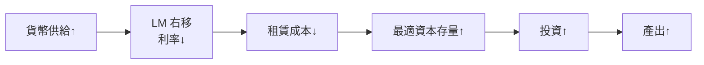

# 貨幣政策（含央行的角色）

> 健康檢查後新增的跨章整合頁：內容全部取自既有 wiki 頁。

## 央行做什麼
- 控制**貨幣供給** $M^s = \bar M$（[IS-LM 模型](../models/IS-LM%20%E6%A8%A1%E5%9E%8B.md)；[第13章 國際連結](../sources/%E7%AC%AC13%E7%AB%A0%20%E5%9C%8B%E9%9A%9B%E9%80%A3%E7%B5%90.md) 第 42 張）
- 固定匯率下，用**外匯存底**買賣外幣干預匯率（[外匯干預與外匯存底](../concepts/%E5%A4%96%E5%8C%AF%E5%B9%B2%E9%A0%90%E8%88%87%E5%A4%96%E5%8C%AF%E5%AD%98%E5%BA%95.md)）
- 浮動匯率下不干預外匯市場，可自由決定貨幣供給（[匯率制度](%E5%8C%AF%E7%8E%87%E5%88%B6%E5%BA%A6.md)）

## 封閉經濟：貨幣擴張的傳導

（[IS-LM 模型](../models/IS-LM%20%E6%A8%A1%E5%9E%8B.md)；利率到投資的環節見[資本的租賃成本](../concepts/%E8%B3%87%E6%9C%AC%E7%9A%84%E7%A7%9F%E8%B3%83%E6%88%90%E6%9C%AC.md)、[投資的決定因素](../synthesis/%E6%8A%95%E8%B3%87%E7%9A%84%E6%B1%BA%E5%AE%9A%E5%9B%A0%E7%B4%A0.md)）

## 開放經濟：效果取決於匯率制度（完全資本移動）
| | 貨幣擴張的效果 | 原因 |
|---|---|---|
| 固定匯率 | ❌ **無效** | 利率低於 $i_f$ → 資本流出、貶值壓力 → 央行賣外匯、收回本幣 → LM 回原位 |
| 浮動匯率 | ✅ **最有效** | 資本流出 → 本幣貶值 → 淨出口↑ → IS 右移 → 產出↑ |
（[Mundell-Fleming 模型](../models/Mundell-Fleming%20%E6%A8%A1%E5%9E%8B.md)、[開放經濟下的政策效果](../synthesis/%E9%96%8B%E6%94%BE%E7%B6%93%E6%BF%9F%E4%B8%8B%E7%9A%84%E6%94%BF%E7%AD%96%E6%95%88%E6%9E%9C.md)）

## 現實例子
美國貨幣緊縮（2022）→ 資金回流美國、美元走強 → 新興市場資本流出、貨幣承壓（[2022 新興市場風險](../events/2022%20%E6%96%B0%E8%88%88%E5%B8%82%E5%A0%B4%E9%A2%A8%E9%9A%AA.md)）。

## 長期
第3章的 Solow 模型中，長期成長由技術決定；第3章第 31 張曾提到「透過貨幣政策影響利率來調整儲蓄率」，wiki 已加註此說法在長期模型中不嚴謹（見[黃金法則](../concepts/%E9%BB%83%E9%87%91%E6%B3%95%E5%89%87.md)）。

## 相關頁
[財政政策](%E8%B2%A1%E6%94%BF%E6%94%BF%E7%AD%96.md)、[IS-LM 模型](../models/IS-LM%20%E6%A8%A1%E5%9E%8B.md)、[Mundell-Fleming 模型](../models/Mundell-Fleming%20%E6%A8%A1%E5%9E%8B.md)、[匯率制度](%E5%8C%AF%E7%8E%87%E5%88%B6%E5%BA%A6.md)、[外匯干預與外匯存底](../concepts/%E5%A4%96%E5%8C%AF%E5%B9%B2%E9%A0%90%E8%88%87%E5%A4%96%E5%8C%AF%E5%AD%98%E5%BA%95.md)、[資本移動性](../concepts/%E8%B3%87%E6%9C%AC%E7%A7%BB%E5%8B%95%E6%80%A7.md)

## 來源
- [第13章 國際連結](../sources/%E7%AC%AC13%E7%AB%A0%20%E5%9C%8B%E9%9A%9B%E9%80%A3%E7%B5%90.md) 第 2、9–11、26–37、42 張
- [第15章 投資支出](../sources/%E7%AC%AC15%E7%AB%A0%20%E6%8A%95%E8%B3%87%E6%94%AF%E5%87%BA.md) 第 7 張
- [第3章 成長與累積](../sources/%E7%AC%AC3%E7%AB%A0%20%E6%88%90%E9%95%B7%E8%88%87%E7%B4%AF%E7%A9%8D.md) 第 31 張
