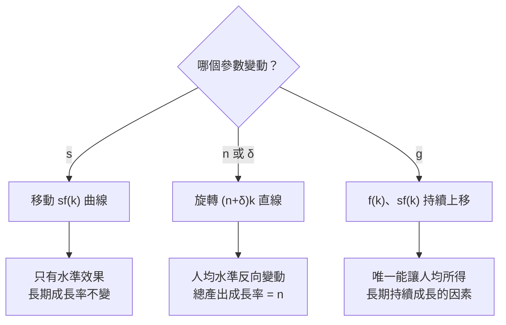

# s、n、g 變動效果比較（Solow 模型總整理）

> 考前用的總表：在 [Solow 新古典成長模型](../models/Solow%20%E6%96%B0%E5%8F%A4%E5%85%B8%E6%88%90%E9%95%B7%E6%A8%A1%E5%9E%8B.md) 裡，各參數變動對**水準**和**成長率**的影響。

## 總表
| 參數變動 | 圖上的移動 | $k^*$、$y^*$（水準） | 過渡期人均成長率 | 穩態人均成長率 | 穩態總產出成長率 |
|---|---|---|---|---|---|
| 儲蓄率 $s$↑ | $sf(k)$ 曲線上移 | ↑ | 暫時↑，再遞減回 0 | 0（不變） | $n$（不變） |
| 人口成長率 $n$↑ | $(n+\delta)k$ 直線變陡 | ↓ | 暫時為負 | 0（不變） | ↑（等於新的 $n$） |
| 人口成長率 $n$↓ | $(n+\delta)k$ 直線變平 | ↑ | 暫時↑ | 0（不變） | ↓（等於新的 $n$） |
| 折舊率 $\delta$↑ | $(n+\delta)k$ 直線變陡 | ↓ | 暫時為負 | 0（不變） | $n$（不變） |
| 技術進步 $g > 0$ | $f(k)$ 和 $sf(k)$ 每年持續上移 | 持續↑ | — | $g$ | $n + g$ |

出處：$s$ 是第 23–25 張；$n$ 是第 26 張；$g$ 是第 27–28 張（[第3章 成長與累積](../sources/%E7%AC%AC3%E7%AB%A0%20%E6%88%90%E9%95%B7%E8%88%87%E7%B4%AF%E7%A9%8D.md)）。$\delta$ 的那一列，以及 $n$ 變動的過渡期，是由模型推得的補充。

## 對穩態人均消費 $c^*$ 的影響
| 變動 | $c^*$ |
|---|---|
| $s$↑，且原本 $s < s_g$ | ↑ |
| $s$↑，且原本 $s > s_g$ | ↓ |
| $n$↑ 或 $\delta$↑ | ↓（補充推論） |

見[黃金法則](../concepts/%E9%BB%83%E9%87%91%E6%B3%95%E5%89%87.md)。

## 判斷流程

## 一句話記憶
- **$s$ 只改水準，不改成長率**：原因是[邊際報酬遞減](../concepts/%E9%82%8A%E9%9A%9B%E5%A0%B1%E9%85%AC%E9%81%9E%E6%B8%9B.md)。
- **$n$ 讓人均變少、總量長得更快**：人更多、成長更快，但每人分到的資本被稀釋。
- **長期人均成長只看 $g$**。

## 常考陷阱
1. 「提高儲蓄率能永久提高成長率」✗
2. 「人口成長率上升使總產出成長率下降」✗（實際上是上升）
3. 「穩態代表總產出不再成長」✗（總產出仍以 $n$ 或 $n+g$ 成長）
4. 「儲蓄率愈高消費愈多」✗（超過黃金法則就相反）
5. 曲線和直線不要搞混：$s$ 動的是**曲線**，$n$、$\delta$ 動的是**直線**。

## 換成內生成長理論會怎樣？（第4章）
在 [內生成長模型 (AK 模型)](../models/%E5%85%A7%E7%94%9F%E6%88%90%E9%95%B7%E6%A8%A1%E5%9E%8B%20%28AK%20%E6%A8%A1%E5%9E%8B%29.md) 中 $g = sa - (n+\delta)$：

| 參數變動 | Solow（本頁總表） | AK 模型 |
|---|---|---|
| $s$↑ | 只提高水準，長期成長率不變 | **長期成長率永久↑** |
| $n$↑ | 人均水準↓，總產出成長率↑ | 人均成長率↓ |
| $\delta$↑ | 人均水準↓ | 人均成長率↓ |

🔀 實證（[巴羅 (Robert Barro)](../people/%E5%B7%B4%E7%BE%85%20%28Robert%20Barro%29.md)）較支持 Solow 的結論。完整比較見[新古典 vs 內生成長理論](%E6%96%B0%E5%8F%A4%E5%85%B8%20vs%20%E5%85%A7%E7%94%9F%E6%88%90%E9%95%B7%E7%90%86%E8%AB%96.md)；政策應用見[成長政策](../policies/%E6%88%90%E9%95%B7%E6%94%BF%E7%AD%96.md)。

## 相關頁
[Solow 新古典成長模型](../models/Solow%20%E6%96%B0%E5%8F%A4%E5%85%B8%E6%88%90%E9%95%B7%E6%A8%A1%E5%9E%8B.md)、[穩態](../concepts/%E7%A9%A9%E6%85%8B.md)、[黃金法則](../concepts/%E9%BB%83%E9%87%91%E6%B3%95%E5%89%87.md)、[損益兩平投資](../concepts/%E6%90%8D%E7%9B%8A%E5%85%A9%E5%B9%B3%E6%8A%95%E8%B3%87.md)、[全要素生產力 (TFP)](../concepts/%E5%85%A8%E8%A6%81%E7%B4%A0%E7%94%9F%E7%94%A2%E5%8A%9B%20%28TFP%29.md)、[新古典 vs 內生成長理論](%E6%96%B0%E5%8F%A4%E5%85%B8%20vs%20%E5%85%A7%E7%94%9F%E6%88%90%E9%95%B7%E7%90%86%E8%AB%96.md)
