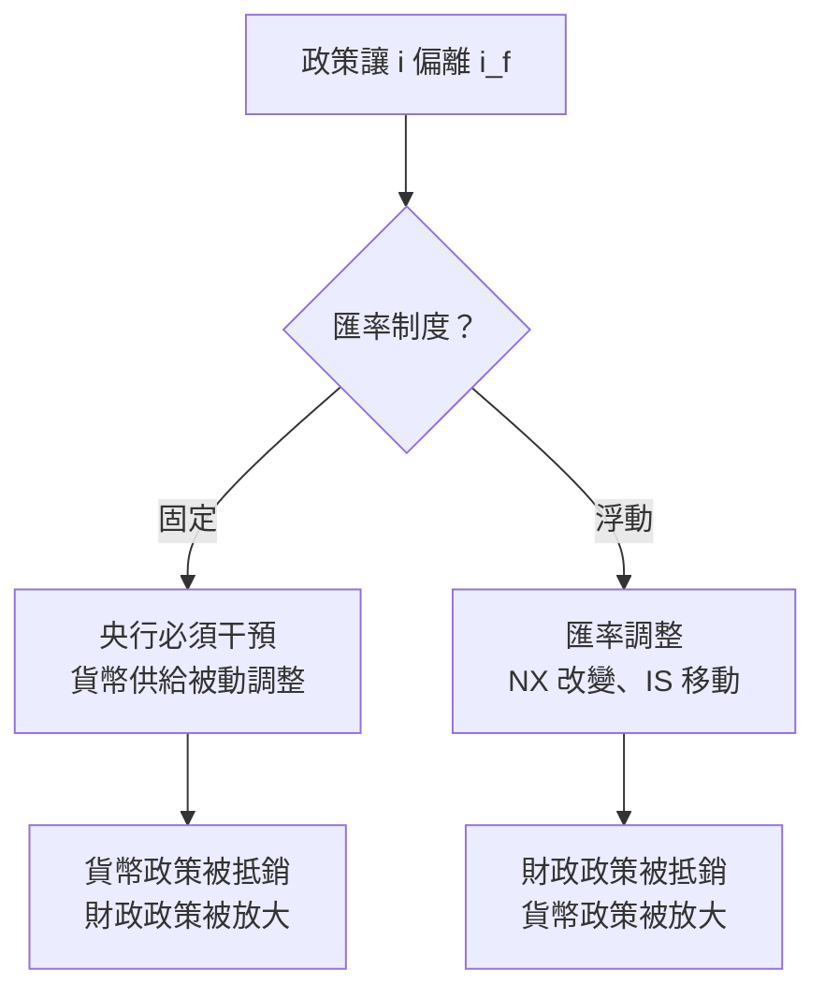

# 開放經濟下的政策效果（完全資本移動）

> 考前四格表：固定 / 浮動匯率 × 貨幣 / 財政政策。（[第13章 國際連結](../sources/%E7%AC%AC13%E7%AB%A0%20%E5%9C%8B%E9%9A%9B%E9%80%A3%E7%B5%90.md) 第 26–37 張，[Mundell-Fleming 模型](../models/Mundell-Fleming%20%E6%A8%A1%E5%9E%8B.md)）

## 四格總表
| | 貨幣擴張 | 財政擴張 |
|---|---|---|
| **固定匯率** | ❌ **無效** LM 右移 → $i < i_f$ → 資本流出、貶值壓力 → 央行賣外匯收回本幣 → LM 回原位 | ✅ **最有效** IS 右移 → $i > i_f$ → 資本流入、升值壓力 → 央行釋出本幣 → LM 也右移 → 產出再增加 |
| **浮動匯率** | ✅ **最有效** LM 右移 → $i < i_f$ → 資本流出、本幣貶值 → NX↑ → IS 右移 → 產出↑ | ❌ **無效** IS 右移 → $i > i_f$ → 資本流入、本幣升值 → NX↓ → IS 推回原位 |

## 判斷流程

## 一句話記憶
- **固定匯率：財政有效，貨幣沒用**——央行守匯率就交出了貨幣的方向盤。
- **浮動匯率：貨幣有效，財政沒用**——匯率自己動，把財政刺激吃掉。

## 補充：不可能三角（非簡報內容）
一國不能同時擁有：①固定匯率 ②資本自由移動 ③獨立貨幣政策，最多只能三選二。Mundell-Fleming 模型的固定匯率結論就是「選了①②，放棄③」。

## 常考陷阱
1. 浮動匯率下財政擴張無效，是因為**升值排擠淨出口**，不是利率排擠投資（利率被釘在 $i_f$）。
2. 固定匯率下貨幣政策無效，是央行**為了守匯率被迫反向操作**。
3. 結論只在「完全資本移動」下成立。
4. 浮動匯率貨幣擴張時，資本是**流出**（⚠️ 簡報第 35 張誤寫為 inflows）。

## 相關頁
[Mundell-Fleming 模型](../models/Mundell-Fleming%20%E6%A8%A1%E5%9E%8B.md)、[匯率制度](../policies/%E5%8C%AF%E7%8E%87%E5%88%B6%E5%BA%A6.md)、[資本移動性](../concepts/%E8%B3%87%E6%9C%AC%E7%A7%BB%E5%8B%95%E6%80%A7.md)、[IS-LM 模型](../models/IS-LM%20%E6%A8%A1%E5%9E%8B.md)、[孟岱爾 (Robert Mundell)](../people/%E5%AD%9F%E5%B2%B1%E7%88%BE%20%28Robert%20Mundell%29.md)
